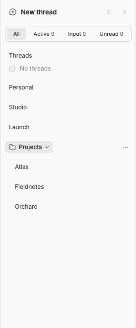
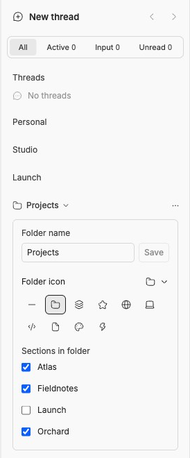

# Sidebar Folders

Group sections, projects, or machines under a collapsible folder in the BB sidebar. Use filters to find active, waiting, or unread threads and give individual threads their own icons.

## Screenshots

| Expanded Projects folder | Folder settings |
| --- | --- |
|  |  |

## Install

Requires **BB 0.50.1** or later, **Plugin SDK 0.6.157** or later, and BB's built-in thread list.

In BB, open **Settings → Plugins → Install from source** and paste:

```text
git:https://github.com/docomoz/bb-plugin-project-section-folder.git@v0.2.0
```

You can also pass the same source to `bb plugin install`.

## Organize the sidebar

- **Custom** groups your BB sections. **Projects** groups projects and **Machines** groups machines. Each mode has its own folder settings.
- Drag a group by its heading onto the folder, or open **⋯** beside the folder and check the groups you want inside. To take a group out, uncheck it or drop it on **Move above folder**.
- Use **Folder name** and **Folder icon** in the same menu. Clear the name and save to restore its default. Choose **No icon** to remove the icon.
- Open **⋯ → Change icon** on a thread to choose from 32 sidebar icons, including **Automations**. Choose **Provider default** to restore the provider icon. BB saves the choice per thread across windows.
- **Active** shows threads where an agent is working. **Input** shows threads waiting for a reply or confirmation. **Unread** includes unread threads in collapsed groups. **All** returns to the regular sidebar.

The folder starts empty. It appears in modes with groups you can put inside it. Folder settings are stored on your BB server. The plugin uses BB's thread and sidebar APIs and requires no external service.

## Verify locally

```sh
npm ci
npm run check
bb plugin build .
```

To load the working copy, pass its absolute path to `bb plugin install path:/path/to/bb-plugin-project-section-folder`. If you already use the plugin, build the copy at its installed path and run `bb plugin reload project-section-folder`.

The plugin's bundled skill documents the configuration RPC.
