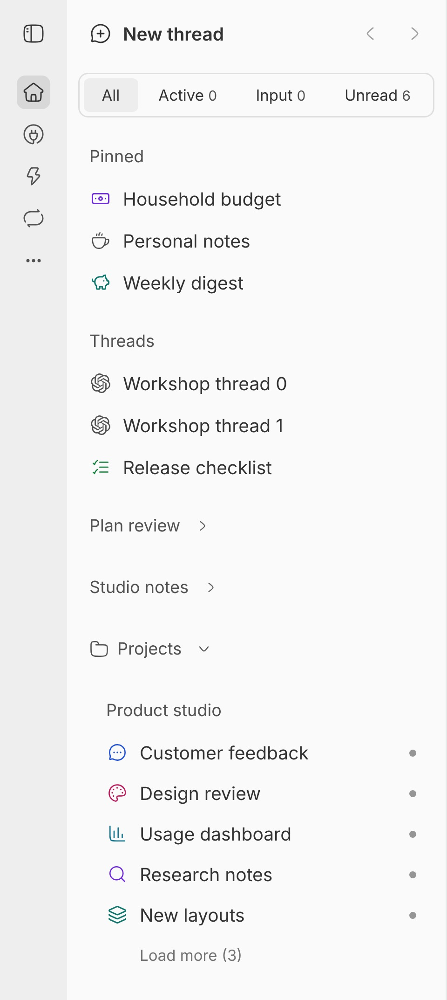
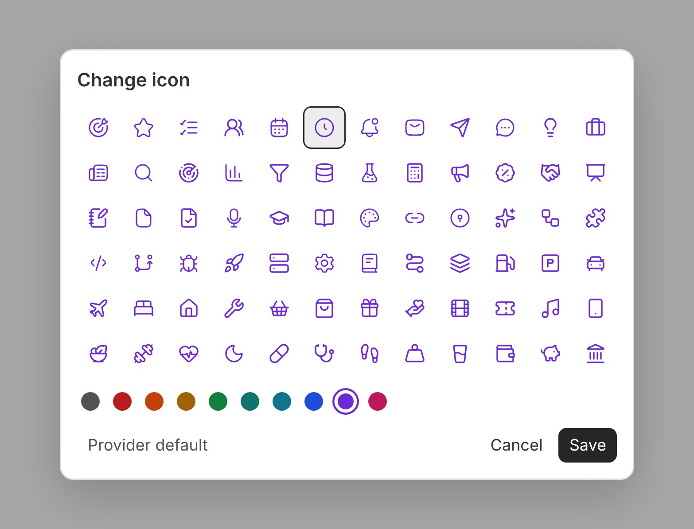
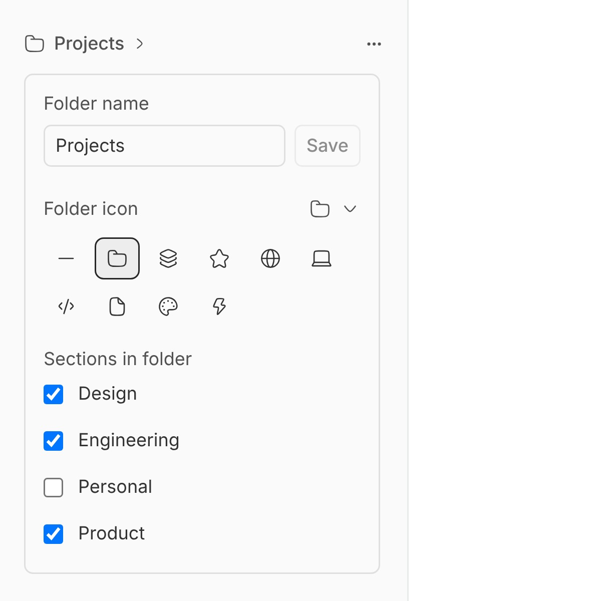
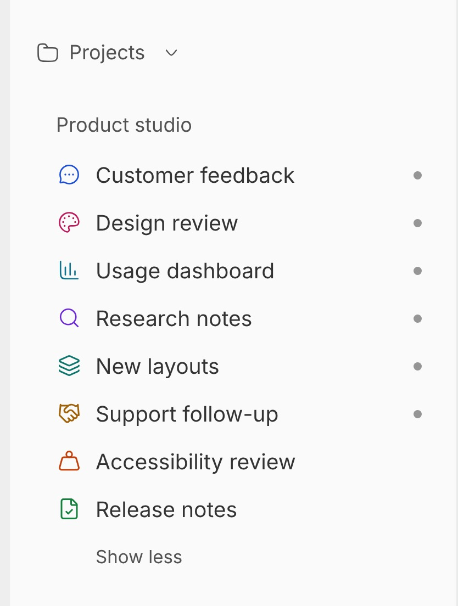

# Sidebar Beautifier

Organize sections, projects, or machines in a collapsible folder in the BB sidebar. Keep long sections short with **Load more** and find active, waiting, or unread threads with filters. Give each thread one of 71 icons and choose from nine colors or the default gray.

## Screenshots

| Sidebar folders and filters | Change a thread icon and color | Configure a folder |
| --- | --- | --- |
|  |  |  |

## Install

Requires **BB 0.50.1** or later, **Plugin SDK 0.6.157** or later, and BB's built-in thread list.

In BB, open **Settings → Plugins → Install from source** and paste:

```text
git:https://github.com/docomoz/bb-plugin-project-section-folder.git@v0.2.6
```

You can also pass the same source to `bb plugin install`.

## Organize the sidebar

- **Custom** groups your BB sections. **Projects** groups projects and **Machines** groups machines. Each mode has its own folder settings.
- Drag a group by its heading onto the folder, or open **⋯** beside the folder and check the groups you want inside. To take a group out, uncheck it or drop it on **Move above folder**.
- Use **Folder name** and **Folder icon** in the same menu. Clear the name and save to restore its default. Choose **No icon** to remove the icon.
- Open **⋯ → Change icon** on a thread to choose from a grid of 71 icons and 9 optional colors besides the default gray. The grid covers strategy, meetings, digests, analytics, maps, AI, health, workouts, expenses, family, and more. On phones it switches to 8 columns with larger targets. Choose **Provider default** and save to restore the provider icon. BB saves each thread’s icon and color across windows.
- **Active** shows threads where an agent is working. **Input** shows threads waiting for a reply or confirmation. **Unread** includes unread threads in collapsed groups. **All** returns to the regular sidebar.
- Filtered rows use the same icon sizing, spacing, and thread menu as **All**. Both provider icons and custom icons appear in the filters.

The folder starts empty. It appears in modes with groups you can put inside it. Folder settings are stored on your BB server. The plugin uses BB's thread and sidebar APIs and requires no external service.

## Limit long sections

Turn on **Enable Load more** under **Settings → Plugins → Sidebar Beautifier**. By default, each custom section and **Threads** shows five top-level threads. **Pinned** has a separate limit of eight that you can turn off. **Load more** reveals five at a time, and **Show less** restores the starting limit. The open thread stays visible, child threads stay with their parent, and each window remembers which sections are expanded until reload.

Adjust the initial limits and reveal step in the same settings. If you have the standalone **Section Load More** plugin, copy its limits to Sidebar Beautifier and disable the standalone plugin before enabling **Load more** here.



## Verify locally

```sh
npm ci
npm run check
bb plugin build .
```

To load the working copy, pass its absolute path to `bb plugin install path:/path/to/bb-plugin-project-section-folder`. If you already use the plugin, build the copy at its installed path and run `bb plugin reload project-section-folder`.

The plugin's bundled skill documents the configuration RPC.

The additional lifestyle icons are from [Lucide](https://lucide.dev/). See [its license](LICENSE-lucide).

Load more is based on [Section Load More by siluthfi](https://github.com/siluthfi/bb-plugin-section-load-more). See [its MIT license](LICENSE-section-load-more).
